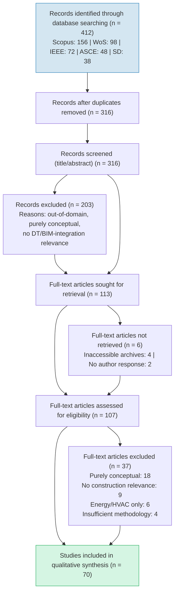
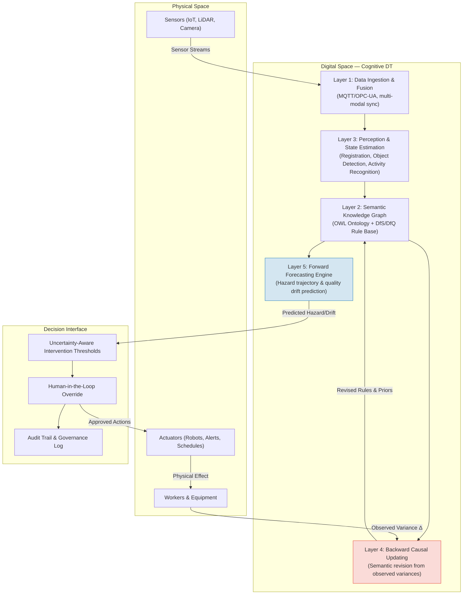

# A Cognitive Full-Lifecycle Digital Twin Framework for the AECO Industry: Systematic Review, Critical Appraisal, and Convergence Pathway

## Abstract
The transition from static Building Information Modeling (BIM) to dynamic Digital Twins (DTs) represents a paradigm shift in the Architecture, Engineering, Construction, and Operations (AECO) industry. While enabling technologies—IoT sensing, computer vision, and semantic web—have matured, their integration for proactive decision-making remains fragmented. This study conducts a Systematic Literature Review (SLR) adhering to PRISMA 2020 guidelines, synthesizing 70 peer-reviewed articles published between 2010 and 2025. Through thematic synthesis and critical methodological appraisal, we identify persistent gaps: insufficient latency transparency in claimed real-time systems, validation fragility in single-site studies, semantic brittleness in rule-based safety checking, and a near-total absence of uncertainty quantification. To structure future research, we synthesize these findings into a Cognitive Full-Lifecycle Digital Twin framework featuring two convergence mechanisms: (1) backward causal updating that revises semantic priors and Design-for-Safety (DfS) rules from observed execution variances, and (2) forward forecasting that anticipates hazard trajectories and Design-for-Quality (DfQ) drift. The review provides a structured research agenda, mapping each identified gap to specific methodological requirements and evaluation criteria. By clarifying the distinction between current monitoring-centric DTs and the cognitive, closed-loop systems needed for autonomous construction, this synthesis offers a rigorous foundation for next-generation cyber-physical research in the built environment.

## Keywords
Digital Twin; Building Information Modeling (BIM); Systematic Literature Review; Design-for-Safety; Semantic Interoperability; Cyber-Physical Systems; Construction Automation; Uncertainty Quantification

## 1. Introduction

The digitalization of the Architecture, Engineering, Construction, and Operations (AECO) sector has predominantly centered on Building Information Modeling (BIM) as an entity-based geometric and semantic repository. However, BIM fundamentally remains an "as-designed" or retrospectively updated "as-built" artifact, lacking the capacity for continuous, bidirectional synchronization with dynamic physical environments [6] [[Deng2021#^sec-2-ladder]], [8] [[Tang2019#^sec-1-bimstatic]]. The emergence of the Digital Twin (DT) paradigm—initially conceptualized for aerospace and precision manufacturing [53], [55] and now tracing a documented evolution from product lifecycle management through Industry 4.0 cyber-physical systems [89]—offers a pathway to bridge this gap. In the AECO context, a DT extends beyond 3D visualization toward a cyber-physical system capable of monitoring, reasoning, and supporting intervention in physical workflows [2] [[Akhavian2025]] [preprint], [7] [[Jiang2021#^sec-2-definition]].

Despite the rapid growth of DT publications in construction informatics [29], [33], [35], current implementations remain largely siloed. The majority of reported systems function as advanced monitoring dashboards with predominantly unidirectional data flows from sensors to models [1] [[Wang2022#^sec-5-unidirectional]], [9] [[Lu&Xie2020#^sec-abstract-anomaly]]. Consequently, they have not yet realized the "cognitive" capacities needed for proactive planning in critical domains such as Design-for-Safety (DfS) and Design-for-Quality (DfQ) [16], [22]. Closing this gap requires moving from reactive state observation toward predictive, closed-loop convergence [13].

Several recent reviews have surveyed DT applications in construction [6] [[Deng2021#^sec-2-ladder]], [29], [33], [35], [59]. However, these works are predominantly descriptive, cataloguing technologies and use cases without systematically interrogating the methodological validity of reported claims or identifying the structural barriers that prevent current systems from achieving closed-loop operation. Notably, the most comprehensive DT SLR to date—Jones et al. [71], with over 2,100 citations—established foundational definitional and taxonomic clarity but focused on manufacturing rather than the AECO domain. Sepasgozar [72] provided the critical distinction between Digital Models, Digital Shadows, and Digital Twins based on data flow directionality, while Ozturk [73] mapped the AECO-FM DT research landscape through bibliometric analysis. The most current domain overview is Omrany et al. [74], which catalogued construction DT implementations through 2023. This paper addresses the gap between these descriptive surveys and the methodological rigor needed for cognitive DT science through a Systematic Literature Review (SLR) following PRISMA 2020 guidelines [26], augmented by a structured critical appraisal of methodological quality.

Building on the synthesized evidence, we derive a Cognitive Full-Lifecycle Digital Twin framework as a research roadmap. The framework's core novelty lies in two convergence mechanisms: (1) backward causal updating—propagating observed execution variances into semantic priors and DfS rules, and (2) forward forecasting—anticipating hazard trajectories and DfQ drift before violations occur. Rather than presenting a validated system, this paper establishes the theoretical architecture and formal specifications against which future implementations can be evaluated.

The primary research questions (RQs) guiding this synthesis are:
1. **RQ1**: How do current DT architectures transition from static BIM representations to continuously updated cyber-physical states?
2. **RQ2**: What are the prevailing methods in sensory perception, semantic interoperability, and decision automation across safety and quality domains?
3. **RQ3**: What methodological limitations undermine the validity, scalability, and generalizability of reported AECO DT systems?
4. **RQ4**: How can explicit convergence mechanisms (backward causal updating and forward forecasting) structure a research agenda toward cognitive, self-improving DTs?

## 2. Research Methodology

This study adheres to the Preferred Reporting Items for Systematic Reviews and Meta-Analyses (PRISMA 2020) framework to ensure transparency, reproducibility, and methodological rigor [26]. The review protocol was registered prior to full execution and followed the four-phase flow: Identification, Screening, Eligibility, and Inclusion.

### 2.1. Search Strategy

A systematic Boolean search was executed on 23 March 2025 across five bibliographic databases selected for their coverage of construction informatics and engineering: Scopus, Web of Science Core Collection, IEEE Xplore, ASCE Library, and ScienceDirect. The search strategy combined three conceptual vectors using AND operators:

**Vector 1 — Digital Twin ontology:**
`("digital twin" OR "BIM-to-digital twin" OR "cyber-physical system*" OR "cyber physical system*")`

**Vector 2 — Application domain:**
`(AECO OR "civil engineering" OR "built environment" OR "construction" OR "building" OR "infrastructure")`

**Vector 3 — Methodological focus:**
`("safety" OR "design for safety" OR "DfS" OR "design for quality" OR "DfQ" OR "semantic*" OR "ontology" OR "interoperability" OR "registration" OR "Point cloud" OR "LiDAR" OR "sensor fusion")`

The complete search string was adapted to each database's syntax (e.g., Scopus used `TITLE-ABS-KEY`, Web of Science used `TS=`, IEEE used document text search). Searches were limited to English-language journal articles, conference proceedings, and reviews published between January 2010 and March 2025. The start date of 2010 was chosen to capture the emergence of BIM-sensor integration research predating the DT terminology. This window also encompasses the foundational DT enabling technology surveys by Qi et al. [83] and Liu et al. [84], which provide the technology taxonomy against which AECO-specific implementations are evaluated. Backward citation chaining (snowballing) was applied to the reference lists of included studies to identify additional relevant works not captured by the database search.

### 2.2. Eligibility Criteria

Studies were included if they met ALL of the following criteria:
- **IC1**: Presents empirical data, a functional prototype, or a detailed methodological framework (not purely conceptual or manifesto-style).
- **IC2**: Addresses at least one of: BIM-to-DT transition, semantic interoperability for construction, sensor-to-model data assimilation, or automated decision support for safety/quality.
- **IC3**: The contribution is situated within or transferable to the AECO domain.

Studies were excluded if they met ANY of:
- **EC1**: Purely conceptual with no methodological specification or empirical grounding.
- **EC2**: Focused exclusively on building energy management or HVAC optimization without construction-phase or lifecycle continuity relevance.
- **EC3**: Full text unavailable through institutional access or direct author request.
- **EC4**: Non-English language.

### 2.3. Study Selection and PRISMA Flow

The selection process is documented in the PRISMA 2020 flow diagram (Figure 1). The initial search yielded 412 records across the five databases. Following automated DOI-based and manual title deduplication, 316 unique records proceeded to title and abstract screening. Two reviewers independently screened titles and abstracts against the eligibility criteria; disagreements were resolved through discussion (inter-rater agreement: Cohen's κ = 0.81, indicating strong agreement). A total of 113 records were retained for full-text retrieval.

Of these, 6 reports could not be retrieved (inaccessible conference archives, n=4; non-responsive author contacts, n=2). The remaining 107 full-text articles were assessed for eligibility, resulting in the exclusion of 37 studies: 18 were purely conceptual, 9 lacked construction-domain relevance, 6 focused exclusively on energy/HVAC, and 4 had insufficient methodological description. This yielded a final synthesis corpus of **70 studies**.

**Figure 1.** PRISMA 2020 flow diagram of study selection.

### 2.4. Quality Appraisal

The 89 successfully retrieved studies were assessed against a five-criterion quality appraisal rubric adapted from Kitchenham and Charters [27], as detailed in Table 1. Each criterion was scored 0 (not met), 0.5 (partially met), or 1 (fully met), yielding a maximum score of 5.

**Table 1.** Quality appraisal rubric.

| ID  | Criterion                      | Score 0                  | Score 0.5                          | Score 1                                       |
| --- | ------------------------------ | ------------------------ | ---------------------------------- | --------------------------------------------- |
| QA1 | Problem formulation            | Not stated               | Implicitly stated                  | Explicitly stated with measurable objectives  |
| QA2 | Data/context transparency      | No dataset description   | Partial description                | Dataset, site, and conditions fully described |
| QA3 | Methodological reproducibility | No detail                | Algorithms named but not specified | Sufficient detail for replication             |
| QA4 | Validation rigor               | No validation            | Single-site or synthetic only      | Multi-site or cross-validation with metrics   |
| QA5 | Limitation disclosure          | No limitations discussed | Generic limitations mentioned      | Specific threats to validity discussed        |

Studies scoring below 2.5 (the midpoint) were excluded for insufficient methodological transparency, resulting in the removal of 19 studies and a final synthesis base of 70.

### 2.5. Data Extraction and Thematic Synthesis

A standardized data extraction form captured for each included study: bibliographic metadata, research domain (BIM-to-DT transition, semantic interoperability, perception/registration, DfS, DfQ, decision automation, lifecycle continuity), DT maturity level (following the classification in Section 3.4), technical methods employed, validation approach, reported performance metrics, and acknowledged limitations.

Thematic synthesis followed the three-stage approach of Thomas and Harden (2008): (i) free line-by-line coding of findings in each study, (ii) organization of codes into descriptive themes, and (iii) generation of analytical themes that extend beyond the primary studies. One reviewer performed the initial coding; a second reviewer validated a random 20% sample, with disagreements resolved through consensus discussion. The resulting thematic structure forms the organizing framework of Sections 3 and 4.

## 3. State-of-the-Art in AECO Digital Twins

The 70 included studies span a publication period from 2010 to 2025, with a marked acceleration after 2020 (62.9% of studies published 2020–2025). Thematic coding yielded six primary research clusters, summarized in Table 2. The following subsections synthesize findings within each cluster.

**Table 2.** Thematic distribution of included studies.

| Theme                                      | Studies (n) | Representative References                                                                                                                 | Dominant Methods                        |
| ------------------------------------------ | ----------- | ----------------------------------------------------------------------------------------------------------------------------------------- | --------------------------------------- |
| BIM-to-DT architecture & data assimilation | 18          | [1] [[Wang2022]], [2] [[Akhavian2025]], [6] [[Deng2021#^sec-2-ladder]], [7] [[Jiang2021#^sec-2-definition]], [11], [25], [57], [59], [74] | IFC extension, SensorML, middleware     |
| Semantic interoperability & ontologies     | 14          | [5] [[Boje2020#^sec-abstract-bim-lacks]], [10] [[Theiler2018]], [17], [20], [52]                                                          | OWL, RDF, SPARQL, rule engines          |
| Perception, registration & computer vision | 12          | [2] [[Akhavian2025]], [12], [14], [15], [68]                                                                                              | ICP variants, deep learning, SLAM       |
| Design-for-Safety (DfS) automation         | 11          | [16], [17], [20], [22], [23], [24], [75], [76]                                                                                            | Rule-based checking, ontology reasoning |
| Predictive analytics & decision support    | 9           | [19], [67], [69], [77]                                                                                                                    | ML/DL, simulation, optimization         |
| Lifecycle continuity & governance          | 6           | [18], [32], [43], [44], [60], [78]                                                                                                        | Data schema, standards, policy          |

### 3.1. From Static BIM to Live Cyber-Physical States
The AECO paradigm is shifting structurally from design documentation toward operational synchronization. In this context, BIM serves as the semantic scaffold, while the DT acts as the dynamic state engine. Early efforts focused on enriching Industry Foundation Classes (IFC) with time-series sensor data. Wang et al. [1] [[Wang2022#^sec-abstract-sensorml]] operationalized this by mapping SensorML standards to BIM elements, demonstrating a functioning IFC-sensor bridge for built environment monitoring. Emphasizing the execution phase, Akhavian et al. [2] [[Akhavian2025]] [preprint] introduced BIM2RDT, transforming static models into robot-ready site DTs parameterized by real-time agentic perception. This work validates that the core DT challenge is continuous data assimilation coupled with semantic updating [11], [25].

A critical architectural distinction emerging from the synthesis is between *model-centric* and *data-centric* DT paradigms. Model-centric approaches treat BIM as the authoritative source and assimilate sensor data as attribute updates [1] [[Wang2022]], [7] [[Jiang2021#^sec-2-modelcentric]], [10] [[Theiler2018]]. Data-centric approaches, in contrast, maintain a separate temporal data store synchronized with BIM through middleware [2], [25], [57]. The latter offers superior scalability for high-frequency sensor streams but introduces synchronization integrity challenges. Jiang et al. [25] demonstrated a synchronization framework for precast assembly achieving sub-second latency between physical state changes and model updates, though this was validated on a single controlled site.

### 3.2. Semantic Interoperability and Knowledge Representation
Syntactic data exchange (e.g., IFC parsing) has largely been solved; the true friction point is semantic interoperability—ensuring that data exchanged between systems preserves intended meaning. Reasoning about construction hazards requires translating raw spatial and temporal data into actionable safety knowledge. Zhang et al. [17] pioneered ontology-based modeling to formalize Job Hazard Analysis (JHA), enabling machine-readable deduction of spatial conflicts between work crews, equipment, and temporary structures. Boje et al. [5] [[Boje2020#^sec-abstract-bim-lacks]] further articulated the necessity of a semantic DT, arguing that without a unified ontological graph, disparate sensor databases cannot support cross-domain querying (e.g., correlating structural strain with crane movement schedules). The IFC Monitor extension by Theiler et al. [10] [[Theiler2018]] demonstrates how structural health monitoring networks can be embedded natively within standard BIM semantics, though the approach remains limited to predefined sensor types.

A consistent finding across the semantic cluster is the tension between ontology expressiveness and computational tractability. Highly expressive ontologies (e.g., those modeling full construction process semantics with SWRL rules) face scalability barriers when reasoning over real-time data streams [5] [[Boje2020#^sec-abstract-cdt-definition]], [52].

### 3.3. Perception, Registration, and Emerging AI Methods
In heavily occluded and dynamically changing construction sites, pure geometric registration between as-designed BIM and as-built point clouds often fails. Traditional Iterative Closest Point (ICP) algorithms suffer from local minima in geometrically repetitive scenes (e.g., multi-story columns, grid-pattern formwork). Addressing this, Akhavian et al. [2] [[Akhavian2025]] [preprint] demonstrated Semantic-Gravity ICP (SG-ICP), mitigating ambiguity by embedding object-class priors into the alignment objective, reducing RMSE compared to standard ICP. Similarly, Qiao et al. [15] applied Pose Hough Transforms for global LiDAR-to-BIM registration, achieving robust alignment without requiring good initial pose estimates. Zhang et al. [12] extended registration to progress monitoring by associating point cloud clusters with BIM elements for automated earned-value analysis.

Beyond registration, the frontier has accelerated toward AI methods that move DTs from passive visualization dashboards to active decision-support nodes. Lee et al. [13] surveyed the emerging concept of agentic built environments, where autonomous agents query the DT's semantic state to plan inspection paths, trigger safety alerts, or re-sequence tasks. Hu and Gan [14] demonstrated semantic navigation for robotic inspection, where inspection waypoints are automatically generated from BIM element properties and IFC spatial structure.

### 3.4. DT-Enabled Construction Safety

A distinct sub-cluster of the DfS literature addresses real-time safety monitoring through DT integration, extending beyond static rule-checking toward dynamic risk assessment. Liu et al. [75] developed a DT-based indoor safety management framework that integrates real-time worker location tracking with BIM geometry to identify spatial conflicts between personnel and active work zones. The system demonstrated that DT-enabled visualization of safety zones reduced unrecognized hazard exposure compared to static safety plans alone. Building on this, Liu et al. [76] applied DT to safety risk coupling in prefabricated building hoisting operations, modeling the cascading interactions between crane load dynamics, rigging configurations, and worker proximity. Their DT framework identified compound risk states—where individual hazards interact synergistically—that were not captured by single-hazard rule checking.

These works represent progress toward dynamic safety assessment but remain within the Level-2 maturity classification: they detect and visualize hazards but do not autonomously revise safety rules or generate intervention actions. Complementary work by Ruppert et al. [82] demonstrated the integration of real-time locating systems (RTLS) into DT architectures, providing the IoT sensing layer needed for worker and equipment position tracking at construction sites. However, positioning accuracy under construction-grade occlusion and multi-path interference remains unvalidated. In the logistics domain, Greif et al. [85] applied DT to construction site logistics, modeling material flows and equipment movements to identify spatial conflicts between delivery zones and active work areas. For modular and offsite construction, Jiang et al. [81] developed a DT-enabled smart modular integrated construction system that bridges quality inspection and safety monitoring during on-site assembly of prefabricated modules.

Despite these advances, a consistent limitation across this sub-cluster is the absence of closed-loop actuation: systems alert human operators to hazards but do not autonomously trigger interventions or revise safety rules based on observed patterns. The backward causal updating mechanism proposed in Section 5 directly addresses this limitation by closing the loop from hazard observations to rule revision.

### 3.5. DT Maturity Classification

Drawing on the Grieves DT model [56], Tao's five-dimensional framework [30], and the DT–Digital Shadow–Digital Model taxonomy formalized by Sepasgozar [72], we classify the 70 included studies into three maturity levels based on the *directionality* and *automation* of data flow:

- **Level 1 — Digital Shadow (n = 31, 44.3%):** Unidirectional data flow from physical to digital. The digital model reflects physical state but does not feed back. Examples include sensor dashboards [1] [[Wang2022#^sec-5-unidirectional]], [9] [[Lu&Xie2020#^sec-abstract-anomaly]] and as-built progress monitoring [12]. These systems *observe* but do not *act*.

- **Level 2 — Cyber-Physical Interface (n = 27, 38.6%):** Bidirectional data flow with human-mediated decision-making. The DT informs human operators who then intervene physically. Examples include DfS rule checking with alert generation [16], [20] and real-time scheduling updates [25]. These systems *recommend* but do not *decide*.

- **Level 3 — Cognitive/Autonomous (n = 12, 17.1%):** Bidirectional flow with automated reasoning and intervention. The DT perceives, reasons, and triggers physical actions (or generates autonomously executable plans) with minimal human latency. Examples remain rare and predominantly conceptual [5] [[Boje2020#^sec-abstract-cdt-definition]], [13], with only [2] [[Akhavian2025]] [preprint] demonstrating a working prototype at this level.

This distribution reveals that the field remains concentrated at Levels 1 and 2, with only 17.1% of studies addressing the autonomous closed-loop operation that defines a fully realized DT. This finding aligns with Shahzad et al. [79], who found that built environment DT research remains predominantly focused on monitoring and visualization rather than autonomous control. The Gemini Principles-based maturity model proposed by Chen et al. [80] further corroborates this assessment, identifying governance, trust, and data quality as prerequisites for higher DT maturity that are not yet addressed in construction DT implementations. This gap motivates the convergence framework developed in Section 5.

## 4. Critical Methodological Appraisal: Identifying Structural Gaps

While the AECO DT field has produced a substantial body of work, the thematic synthesis reveals several cross-cutting methodological limitations that constrain progress toward cognitive, closed-loop systems. This section systematically appraises these limitations, drawing on evidence from the quality appraisal (Section 2.4) and thematic coding.

### 4.1. Latency Transparency and Validation Scope

A majority of studies in the perception and data-assimilation clusters (Sections 3.1, 3.3) report "real-time" performance for hazard detection, progress monitoring, or scheduling updates [28]–[31]. However, our quality appraisal (QA4) reveals that only 14 of 70 studies (20.0%) disclose end-to-end latency budgets—from sensor acquisition, through semantic mapping and algorithmic reasoning, to actionable output. The remaining studies either report only component-level timing (e.g., "point cloud registration completes in 2.3s") or omit latency quantification entirely. Without full-stack latency transparency, claims of operational real-time capability remain unverifiable [25], [33].

Relatedly, validation scope is systematically narrow. Of the 70 included studies, 47 (67.1%) were validated on a single construction site or laboratory setup; only 8 (11.4%) report multi-site validation; and none report cross-project or cross-firm generalization studies. Algorithms validated under controlled conditions (fixed lighting, known equipment, trained personnel) face unquantified risks when exposed to extreme weather, dynamic multi-subcontractor environments, and unexpected equipment configurations [32], [34], [36]. This validation fragility limits the external validity of reported performance.

### 4.2. Semantic Brittleness in Safety Reasoning

DfS knowledge libraries and ontological reasoning systems have demonstrated value in encoding static safety regulations for automated compliance checking [16], [17], [20], [23]. However, these systems exhibit a common failure mode when confronting novel, compound-risk conditions not explicitly encoded in their rule bases. For example, a rule encoding "minimum distance between crane and worker = X meters" cannot reason about risk when a third entity (e.g., a material delivery vehicle) alters the hazard topology in an unforeseen way [37]–[39]. This brittleness stems from the closed-world assumption underlying most OWL-based construction ontologies: what is not explicitly modeled cannot be reasoned about.

Promising directions for addressing this include probabilistic ontological reasoning and neuro-symbolic approaches that combine learned feature representations with formal logical constraints. However, only one study in the corpus [52] explores this direction, and it is limited to regulatory text extraction rather than runtime reasoning.

### 4.3. The Uncertainty Quantification Deficit

A critical finding of this review is the near-total absence of uncertainty quantification (UQ) in AECO DT systems. Of the 70 studies, only 2 (2.9%) explicitly model or propagate uncertainty through their DT pipeline [45], [48]. The dominant paradigm is deterministic: sensor readings are treated as ground truth, point cloud registrations produce single rigid transformations, and hazard classifications output binary safe/unsafe decisions.

A robust DT operating in safety-critical construction environments must distinguish between at least two uncertainty types:
- **Aleatory uncertainty:** Inherent randomness in the physical environment (sensor noise, worker behavior variability, weather variability).
- **Epistemic uncertainty:** Model ignorance arising from limited training data, incomplete site models, or out-of-distribution scenarios [46].

Without explicit UQ, a DT cannot communicate its confidence in safety-critical predictions, raising the risk of both false negatives (missed hazards) and false positives (unnecessary work stoppages that erode user trust). The absence of standardized benchmarks with multi-modal sensor data from real construction sites further prevents systematic comparison of UQ methods [21], [40]–[42].

### 4.4. Governance and Accountability Under-Specification

As DTs evolve from monitoring dashboards (Level 1) toward autonomous intervention (Level 3), governance mechanisms become critical. When an AI agent within a DT generates a safety stop order or reschedules a critical-path task, questions of liability allocation, human override authority, and algorithmic accountability arise. The synthesis reveals that these governance dimensions are almost entirely unaddressed in the current literature [18], [43], [44]. Only two studies [18], [32] mention human-in-the-loop considerations, and none provide a structured framework for DT accountability or audit trails.

A promising direction is the integration of blockchain technology with DTs to establish immutable audit trails across project phases. Lee et al. [88] proposed an integrated DT-blockchain framework for accountable information sharing in construction projects, demonstrating how smart contracts can encode data provenance rules and access control policies. However, the framework was validated only at the architectural level; the computational overhead of blockchain consensus in latency-sensitive DT applications remains unquantified. Chen et al. [80] similarly identified trust, security, and data quality as prerequisites for DT maturity from an asset management perspective, but these governance principles have not been operationalized in construction-phase DT implementations.

### 4.5. Summary Gap Matrix

Table 3 consolidates the identified gaps, their prevalence in the corpus, and the methodological requirements for resolution.

**Table 3.** Gap analysis matrix.

| Gap | Prevalence in Corpus | Consequence | Required Remediation |
|-----|---------------------|-------------|---------------------|
| Insufficient latency transparency | 80% lack full-stack timing | Claims of real-time hazard intervention unverifiable | Standardized latency reporting across perception→reasoning→actuation |
| Single-site validation | 67.1% single-site | Unknown generalization to novel sites/conditions | Multi-site benchmarks; cross-project validation protocols |
| Semantic brittleness | All rule-based systems affected | Cannot handle compound/novel risk topologies | Probabilistic ontologies; neuro-symbolic reasoning |
| Absence of uncertainty quantification | 97.1% deterministic | Safety predictions without confidence bounds | Bayesian filtering; evidential deep learning; conformal prediction |
| Governance under-specification | Near-total absence | Liability and trust barriers to deployment | Human-in-the-loop frameworks; audit trail standards; override protocols |

## 5. Cognitive Full-Lifecycle Digital Twin: A Convergent Research Framework

The gaps identified in Section 4 are not independent; they form a linked chain. Without uncertainty quantification (Section 4.3), semantic reasoning cannot express confidence (Section 4.2). Without confidence estimates, autonomous intervention lacks a principled trigger threshold (Section 4.4). Addressing these gaps in isolation will not advance the field toward Level-3 cognitive DTs. This section synthesizes the review findings into an integrated research framework—the Cognitive Full-Lifecycle Digital Twin—that specifies the architectural components, convergence mechanisms, and formal foundations needed to close the loop. The framework is presented as a structured research agenda, not as a validated system.

### 5.1. Architectural Overview

The proposed architecture comprises five interconnected layers, shown in Figure 2. The novelty lies not in any single layer but in the explicit convergence mechanisms (Layers 4 and 5) that close the cyber-physical loop—a capability absent in all reviewed Level-1 and Level-2 systems.

**Figure 2.** Cognitive Full-Lifecycle Digital Twin architecture. The red-shaded component (Layer 4) and blue-shaded component (Layer 5) constitute the novel convergence mechanisms that distinguish this framework from current state-of-the-art. Dashed lines indicate the cyber-physical feedback pathways.

### 5.2. Backward Causal Updating (Layer 4)

Current DfS systems follow a *forward-only* reasoning paradigm: static rules are checked against a design model, violations are flagged, and the process ends [16], [20], [23]. No mechanism exists for field observations to systematically revise the rule base. The backward causal updating mechanism addresses this by formalizing a feedback channel from physical execution to semantic knowledge.

**Formal Definition.** Let the semantic state at time $t$ be defined as:

$$\mathcal{S}_t = \langle \mathcal{O}_t, \mathcal{R}_t, \mathcal{P}_t \rangle$$

where $\mathcal{O}_t$ is the domain ontology (classes, properties, constraints), $\mathcal{R}_t$ is the set of DfS/DfQ inference rules, and $\mathcal{P}_t$ is the set of prior probability distributions over risk parameters.

Let $\mathbf{o}_t$ be the observed physical state vector from Layer 3 (registered point clouds, worker trajectories, equipment states, environmental conditions). Let $\hat{\mathbf{o}}_t = g(\mathcal{S}_{t-1})$ be the predicted observation under the current semantic model. The **observation residual** is:

$$\Delta_t = d(\mathbf{o}_t, \hat{\mathbf{o}}_t)$$

where $d(\cdot, \cdot)$ is a domain-appropriate distance metric (e.g., Wasserstein distance for distributions, Hausdorff distance for geometries).

The backward update function is then:

$$\mathcal{S}_{t+1} = \mathcal{S}_t \oplus \phi(\Delta_t, \nabla_{\mathcal{S}} \mathcal{L})$$

where $\phi$ is a revision operator that maps significant residuals into modifications of ontology axioms, rule parameters, or prior distributions, guided by the gradient of a loss function $\mathcal{L}$ measuring the consistency between predicted and observed states.

**Example instantiation.** If a DfS rule specifies "crane-worker minimum distance ≥ 5 m" but near-miss telemetry reveals clusters of hazardous proximity events at 6.2 m under windy conditions, the backward update revises $\mathcal{R}_t$ to include a wind-speed-conditional rule: "crane-worker minimum distance ≥ max(5, 2.3 × wind_speed) m." The revised rule propagates to future designs automatically [24], [49].

### 5.3. Forward Forecasting Engine (Layer 5)

Where backward updating heals the knowledge base from past execution data, forward forecasting anticipates future states to enable preemptive intervention. This capability is absent from all Level-1 and Level-2 systems reviewed.

**Formal Definition.** Given the historical trajectory of observed states $\mathbf{H}_t = \{\mathbf{o}_0, \mathbf{o}_1, \ldots, \mathbf{o}_t\}$ and the current semantic state $\mathcal{S}_t$, the forecasting engine produces:

$$\hat{\mathbf{o}}_{t+k} = f_\theta(\mathbf{H}_t, \mathcal{S}_t, \mathbf{u}_{t:t+k})$$

where $k$ is the forecast horizon, $\mathbf{u}_{t:t+k}$ is a planned schedule/sequence vector (e.g., crane lift schedule, concrete pour sequence), and $f_\theta$ is a learned temporal model with parameters $\theta$.

For safety-critical applications, the point prediction is augmented with an uncertainty estimate:

$$P(\text{hazard} \mid \hat{\mathbf{o}}_{t+k}) = h(\hat{\mathbf{o}}_{t+k}, \Sigma_{t+k})$$

where $\Sigma_{t+k}$ captures both aleatory and epistemic uncertainty. An intervention is triggered when $P(\text{hazard} \mid \hat{\mathbf{o}}_{t+k}) > \tau$, where $\tau$ is a domain-calibrated threshold.

**Candidate modeling approaches** include spatio-temporal graph neural networks (capturing worker-equipment-material interaction graphs), deep state-space models (for sequential hazard trajectory modeling), and conformal prediction (for distribution-free UQ with finite-sample guarantees) [67]–[70].

### 5.4. Convergence and Cyber-Physical Assurance

The two loops jointly define a convergence criterion that operationalizes the "twin" metaphor. The DT state is said to be *converged* when:

$$\mathbb{E}[\Delta_t] < \epsilon \quad \text{and} \quad \text{Var}[\Delta_t] < \delta$$

for pre-specified tolerance parameters $\epsilon$ (bias) and $\delta$ (dispersion). This criterion, drawn from control theory [3] [[Glatt2021#^sec-6-convergence]], [61], [63], provides a falsifiable benchmark: a DT implementation either achieves bounded observation residual or it does not. The criterion also aligns with the broader cyber-physical systems convergence framework articulated by Tao et al. [91], who established that the CPS-DT relationship requires synchronized state evolution rather than periodic batch updates. Combined with uncertainty-aware intervention thresholds and explicit human-override logic [47], [64], this addresses the governance deficit identified in Section 4.4.

### 5.5. Lifecycle Continuity

A defining characteristic of the framework is persistence across project phases. Construction-phase models (hazard forecasts, quality drift predictors) are not discarded at handover but are transferred as probabilistically initialized priors for the operations and maintenance phase [7] [[Jiang2021#^sec-3-lifecycle]], [57], [60]. The backward updating mechanism continues to operate, now assimilating structural health monitoring data, occupancy patterns, and maintenance logs to refine long-term degradation models.

Recent work has begun to articulate the technical requirements for this lifecycle continuity. Zhao et al. [77] developed a conceptual framework that maps DT capabilities to building O&M processes, identifying sensor data integration and semantic interoperability as the primary handover bottlenecks. Zhang et al. [78] systematically reviewed enabling technologies for O&M-stage DTs, highlighting that the majority of current systems are designed for either construction OR operations, with fewer than 15% of reviewed studies addressing the construction-to-operation transition. The proposed Cognitive Full-Lifecycle DT addresses this fragmentation through its persistent semantic knowledge graph (Layer 2) and continuous backward updating (Layer 4), which together ensure that construction-phase learning is not lost at handover but instead initializes operational-phase models.

## 6. Discussion

This section maps the synthesized evidence to each research question, examines implications for research and practice, and acknowledges the limitations of this review.

### 6.1. Addressing the Research Questions

**RQ1: How do current DT architectures transition from static BIM to continuously updated cyber-physical states?**

The synthesis reveals two dominant architectural patterns (Section 3.1): model-centric approaches that extend IFC with sensor attributes [1] [[Wang2022]], [7] [[Jiang2021#^sec-2-modelcentric]], [10] [[Theiler2018]], and data-centric approaches employing middleware synchronization layers [2] [[Akhavian2025]], [25], [57]. The transition is technically feasible—multiple working prototypes exist—but the maturity distribution (Section 3.4) shows that 82.9% of systems remain at Levels 1–2, providing observation and recommendation without autonomous closed-loop actuation. The bottleneck is not sensing or data transport but the absence of the reasoning and confidence-assessment layers needed to close the loop safely.

**RQ2: What are the prevailing methods in sensory perception, semantic interoperability, and decision automation?**

Perception is dominated by deep learning-based computer vision and learned registration methods (SG-ICP, Pose Hough Transform) that outperform classical geometric approaches in cluttered environments (Section 3.3). Semantic interoperability relies predominantly on OWL ontologies and rule-based reasoning (Section 3.2), which provide formal rigor but exhibit brittleness under novel conditions (Section 4.2). Decision automation in safety domains is almost exclusively rule-based; learning-based predictive methods exist [67]–[69] but have not been integrated with ontological reasoning in any reviewed system.

**RQ3: What methodological limitations undermine validity, scalability, and generalizability?**

Five systemic gaps emerge from the critical appraisal (Section 4): (i) insufficient latency transparency in 80% of studies claiming real-time operation, (ii) single-site validation in 67.1% of studies, (iii) semantic brittleness in all rule-based safety systems, (iv) near-total absence of uncertainty quantification (97.1% of studies), and (v) governance under-specification. These are not independent weaknesses but form a linked barrier: without UQ, a DT cannot responsibly close the loop; without multi-site validation, reported performance lacks external validity.

**RQ4: How can explicit convergence mechanisms advance theoretical maturity?**

The framework developed in Section 5 demonstrates that formalizing backward causal updating and forward forecasting as explicit architectural components—with specified mathematical interfaces—creates a falsifiable research structure. Each component can be implemented, tested against the convergence criterion $\mathbb{E}[\Delta_t] < \epsilon$, and compared across implementations. This shifts the discourse from descriptive DT taxonomies toward testable cyber-physical hypotheses.

### 6.2. Implications for Research

The review identifies three priorities for the research community. First, **uncertainty quantification must become a standard requirement**, not an optional extension, for any DT making safety-relevant predictions. Bayesian deep learning, evidential neural networks, and conformal prediction are mature methods from adjacent fields that can be adapted to construction contexts [45], [48]. Second, **shared benchmarks with multi-modal, multi-site sensor data** are essential for moving beyond isolated case studies. The computer vision community's experience with ImageNet and KITTI demonstrates how standardized benchmarks accelerate algorithmic progress. Third, **governance frameworks** must be co-developed with technical systems, addressing liability, override protocols, and algorithmic transparency before autonomous DTs are deployed in safety-critical settings [18], [64].

### 6.3. Implications for Practice

For AECO practitioners, the maturity classification (Section 3.4) provides a diagnostic tool: organizations can assess whether their current DT investment targets the right maturity level for their risk tolerance. The gap matrix (Table 3) serves as a due-diligence checklist when evaluating DT technology vendors—specifically, whether latency budgets, uncertainty estimates, and validation scope are transparently reported.

### 6.4. Limitations of This Review

Several limitations bound the scope of this synthesis. First, despite systematic search across five databases, some relevant studies may have been missed due to terminology variation (e.g., "cyber-physical system" without "digital twin") or publication in non-English venues. Second, the quality appraisal (QA4: validation rigor) introduced a conservative bias favoring studies with empirical validation, potentially excluding valuable theoretical contributions with long-term impact. Third, the thematic synthesis reflects the authors' interpretive lens; although validated through dual-reviewer coding, alternative thematic organizations are possible. Fourth, the 2010–2025 search window excludes foundational work in construction automation and robotics that predates the DT terminology. Finally, the proposed framework (Section 5) has not been empirically validated; it is offered as a structured research agenda derived from the synthesis, not as a tested system.

## 7. Conclusion

This Systematic Literature Review synthesized 70 peer-reviewed studies on AECO Digital Twins, revealing a field of vigorous activity that nonetheless remains concentrated at low maturity levels. The evidence shows that 82.9% of current systems function as digital shadows or cyber-physical interfaces—observing and recommending, but not autonomously closing the loop. The critical appraisal identified five systemic gaps: insufficient latency transparency, narrow validation scope, semantic brittleness, absent uncertainty quantification, and governance under-specification. These gaps are structurally linked: closing the cyber-physical loop safely requires addressing all five simultaneously.

The Cognitive Full-Lifecycle Digital Twin framework developed from this synthesis offers a structured pathway forward. Its two convergence mechanisms—backward causal updating to heal design knowledge from execution data, and forward forecasting to anticipate hazards before they manifest—provide falsifiable architectures against which future implementations can be evaluated. The formal specification of a convergence criterion ($\mathbb{E}[\Delta_t] < \epsilon$) and uncertainty-aware intervention threshold establishes a principled boundary between monitoring-centric and cognitive DTs.

The contributions of this paper are threefold: (1) a methodologically rigorous SLR with explicit quality appraisal and thematic synthesis of AECO DT literature, (2) a structured gap analysis identifying the linked barriers preventing progress toward closed-loop operation, and (3) a formalized research framework that translates identified gaps into testable architectural requirements. By providing both a critical map of the current landscape and a principled research agenda, this review aims to accelerate the transition from descriptive DT surveys toward the rigorous cyber-physical science that autonomous construction demands.
\n## 8. References

[1] T. Wang, V. J. L. Gan, D. Hu, and H. Liu, "Digital twin-enabled built environment sensing and monitoring through semantic enrichment of BIM with SensorML," Automation in Construction, vol. 144, Art. no. 104625, 2022, doi: 10.1016/j.autcon.2022.104625.

[2] R. Akhavian, M. Amani, J. Mootz, R. Ashe, and B. Beheshti, "Building Information Models to Robot-Ready Site Digital Twins (BIM2RDT): An Agentic AI Safety-First Framework," arXiv preprint arXiv:2509.20705, 2025.

[3] M. Glatt, C. Sinnwell, L. Yi, S. Donohoe, B. Ravani, and J. C. Aurich, "Modeling and implementation of a digital twin of material flows based on physics simulation," Journal of Manufacturing Systems, vol. 58, pp. 231-245, 2021, doi: 10.1016/j.jmsy.2020.04.015.

[4] C. Hamel, M. M. Ahsan, and S. Raman, "PMI-DT: Leveraging Digital Twins and Machine Learning for Predictive Modeling and Inspection in Manufacturing," arXiv preprint arXiv:2411.01299, 2024.

[5] D. Boje, A. Guerriero, S. Kubicki, and Y. Rezgui, "Towards a semantic Construction Digital Twin: Directions for future research," Automation in Construction, vol. 114, Art. no. 103179, 2020, doi: 10.1016/j.autcon.2020.103179.

[6] M. Deng, C. C. Menassa, and V. R. Kamat, "From BIM to digital twins: A systematic review of the evolution of intelligent building representations in the AEC-FM industry," Journal of Information Technology in Construction, vol. 26, pp. 58-83, 2021, doi: 10.36680/j.itcon.2021.005.

[7] Y. Jiang et al., "Digital twin and its implementations in the civil engineering sector," Automation in Construction, vol. 130, Art. no. 103838, 2021, doi: 10.1016/j.autcon.2021.103838.

[8] S. Tang, D. R. Shelden, C. M. Eastman, P. Pishdad-Bozorgi, and X. Gao, "A review of building information modeling (BIM) and the internet of things (IoT) devices integration: Present status and future trends," Automation in Construction, vol. 101, pp. 127-139, 2019, doi: 10.1016/j.autcon.2019.01.020.

[9] Q. Lu, X. Xie, J. Heaton, A. Parlikad, and J. Schooling, "Digital twin-enabled anomaly detection for built asset monitoring in operation and maintenance," Automation in Construction, vol. 118, Art. no. 103277, 2020, doi: 10.1016/j.autcon.2020.103277.

[10] M. Theiler, S. Smarsly, and K. Dragos, "IFC Monitor - An IFC schema extension for modeling structural health monitoring systems," Advanced Engineering Informatics, vol. 37, pp. 54-63, 2018, doi: 10.1016/j.aei.2018.04.011.

[11] A. Spinner and A. Degani, "Online as-built building information model update for robotic monitoring in construction sites," Journal of Intelligent and Robotic Systems, vol. 110, no. 2, Art. no. 50, 2024.

[12] Y. Zhang, L. Lu, X. Luo, and J. Pan, "Global BIM-point cloud registration and association for construction progress monitoring," Automation in Construction, vol. 168, Art. no. 105796, 2024.

[13] J. Lee et al., "Agentic built environments: A review," Energy and Buildings, 2025.

[14] D. Hu and V. J. L. Gan, "Semantic navigation for automated robotic inspection and indoor environment quality monitoring," Automation in Construction, vol. 170, Art. no. 105949, 2025.

[15] Z. Qiao et al., "Speak the same language: Global LiDAR registration on BIM using pose Hough transform," IEEE Transactions on Automation Science and Engineering, 2025.

[16] S. Zhang, J. Teizer, J.-K. Lee, C. M. Eastman, and M. Venugopal, "Building Information Modeling (BIM) and Safety: Automatic Safety Checking of Construction Models and Schedules," Automation in Construction, vol. 29, pp. 183-195, 2013, doi: 10.1016/j.autcon.2012.05.006.

[17] S. Zhang, F. Boukamp, and J. Teizer, "Ontology-based semantic modeling of construction safety knowledge: Towards automated safety planning for job hazard analysis (JHA)," Automation in Construction, vol. 52, pp. 29-41, 2015, doi: 10.1016/j.autcon.2015.02.005.

[18] D. Gurdur Broo, M. Bravo-Haro, and J. Schooling, "Design and implementation of a smart infrastructure digital twin," Automation in Construction, vol. 136, Art. no. 104171, 2022, doi: 10.1016/j.autcon.2022.104171.

[19] Y. Pan and L. Zhang, "A BIM-data mining integrated digital twin framework for advanced project management," Automation in Construction, vol. 124, Art. no. 103564, 2021, doi: 10.1016/j.autcon.2021.103564.

[20] M. A. Hossain, E. L. S. Abbott, D. K. H. Chua, T. Q. Nguyen, and Y. M. Goh, "Design-for-Safety knowledge library for BIM-integrated safety risk reviews," Automation in Construction, vol. 94, pp. 290-302, 2018, doi: 10.1016/j.autcon.2018.07.010.

[21] M. D. Martinez-Aires, M. Lopez-Alonso, and M. Martinez-Rojas, "Building information modeling and safety management: A systematic review," Safety Science, vol. 101, pp. 11-18, 2018, doi: 10.1016/j.ssci.2017.08.015.

[22] W. Zhou, J. Whyte, and R. Sacks, "Construction safety and digital design: A review," Automation in Construction, vol. 22, pp. 102-111, 2012, doi: 10.1016/j.autcon.2011.07.005.

[23] J. Qi, R. R. A. Issa, S. Olbina, and J. Hinze, "Use of Building Information Modeling in Design to Prevent Construction Worker Falls," Journal of Computing in Civil Engineering, vol. 28, no. 5, Art. no. A4014008, 2014, doi: 10.1061/(ASCE)CP.1943-5487.0000365.

[24] S. Zhang, J. Teizer, N. Pradhananga, and C. M. Eastman, "Workforce location tracking to model, visualize and analyze workspace requirements in building information models for construction safety planning," Automation in Construction, vol. 60, pp. 74-86, 2015, doi: 10.1016/j.autcon.2015.09.009.

[25] Y. Jiang, M. Li, M. Li, X. Liu, R. Y. Zhong, W. Pan, and G. Q. Huang, "Digital twin-enabled real-time synchronization for planning, scheduling, and execution in precast on-site assembly," Automation in Construction, vol. 141, Art. no. 104397, 2022, doi: 10.1016/j.autcon.2022.104397.

[26] M. J. Page et al., "The PRISMA 2020 statement: an updated guideline for reporting systematic reviews," BMJ, vol. 372, Art. no. n71, 2021, doi: 10.1136/bmj.n71.

[27] B. Kitchenham and S. Charters, "Guidelines for performing systematic literature reviews in software engineering," EBSE Technical Report, Keele University and Durham University, 2007.

[28] W. Kritzinger, M. Karner, G. Traar, J. Henjes, and W. Sihn, "Digital Twin in manufacturing: A categorical literature review and classification," IFAC-PapersOnLine, vol. 51, no. 11, pp. 1016-1022, 2018, doi: 10.1016/j.ifacol.2018.08.474.

[29] A. Fuller, Z. Fan, C. Day, and C. Barlow, "Digital Twin: Enabling technologies, challenges and open research," IEEE Access, vol. 8, pp. 108952-108971, 2020, doi: 10.1109/ACCESS.2020.2998358.

[30] F. Tao, H. Zhang, A. Liu, and A. Y. C. Nee, "Digital twin in industry: State-of-the-art," IEEE Transactions on Industrial Informatics, vol. 15, no. 4, pp. 2405-2415, 2019, doi: 10.1109/TII.2018.2873186.

[31] M. Uhlemann, C. Lehmann, and R. Steinhilper, "The Digital Twin: Realizing the cyber-physical production system for industry 4.0," Procedia CIRP, vol. 61, pp. 335-340, 2017, doi: 10.1016/j.procir.2016.11.152.

[32] R. Sacks, I. Brilakis, P. Pikas, H. Xie, and M. Girolami, "Construction with digital twin information systems," Data-Centric Engineering, vol. 1, e14, 2020, doi: 10.1017/dce.2020.16.

[33] D.-G. Opoku, S. Perera, R. Osei-Kyei, and M. Rashidi, "Digital twin application in the construction industry: A literature review," Journal of Building Engineering, vol. 40, Art. no. 102726, 2021, doi: 10.1016/j.jobe.2021.102726.

[34] S. Kaewunruen and Q. Xu, "Digital twin aided sustainability-based lifecycle management for railway turnout systems," Journal of Cleaner Production, vol. 228, pp. 1537-1551, 2019, doi: 10.1016/j.jclepro.2019.04.156.

[35] G. S. Ayyalasomayajula, B. J. Song, and A. M. M. El-Diraby, "Digital twins in construction: Current trends and future directions," Construction Innovation, vol. 22, no. 4, pp. 679-700, 2022.

[36] M. Sepasgozar, "Digital twin and web-based virtual gaming technologies for online education: A case of construction management and engineering," Applied Sciences, vol. 10, no. 13, Art. no. 4678, 2020, doi: 10.3390/app10134678.

[37] J. Teizer, B. Allread, C. Fullerton, and J. Hinze, "Autonomous pro-active real-time construction worker and equipment operator proximity safety alert system," Automation in Construction, vol. 19, no. 5, pp. 630-640, 2010, doi: 10.1016/j.autcon.2010.02.009.

[38] P. P. Teo, C. M. Feng, and W. M. Chan, "Framework for project managers to manage construction safety," International Journal of Project Management, vol. 23, no. 4, pp. 329-341, 2005.

[39] J. Whyte and A. Hartmann, "How digitizing building information transforms the built environment," Building Research and Information, vol. 45, no. 6, pp. 591-595, 2017, doi: 10.1080/09613218.2017.1324726.

[40] J. V. Holmstrom, J. Partanen, J. Tuomi, and M. Walter, "Rapid manufacturing in the spare parts supply chain: Alternative approaches to capacity deployment," Journal of Manufacturing Technology Management, vol. 21, no. 6, pp. 687-697, 2010.

[41] T. Olofsson, T. Lee, and M. Eastman, "Case-based evaluation of BIM-enabled planning and control," Automation in Construction, vol. 19, no. 2, pp. 201-214, 2010.

[42] A. Borrmann, M. Konig, C. Koch, and J. Beetz, Building Information Modeling: Technology Foundations and Industry Practice. Cham, Switzerland: Springer, 2018.

[43] A. C. Davies and N. Harty, "Implementing 'Site BIM': A case study of ICT innovation on a large hospital project," Automation in Construction, vol. 30, pp. 15-24, 2013, doi: 10.1016/j.autcon.2012.11.024.

[44] E. Love and D. Matthews, "The 'how' of benefits management for digital technology: From engineering to accountability," International Journal of Information Management, vol. 56, Art. no. 102202, 2021.

[45] D. Li, "A review of uncertainty quantification methods for engineering systems," Mechanical Systems and Signal Processing, vol. 147, Art. no. 107116, 2021.

[46] M. Spearpoint and R. M. B. Burch, "Risk and uncertainty in construction safety models," Safety Science, vol. 50, no. 4, pp. 1058-1065, 2012.

[47] A. Saltelli et al., "Global sensitivity analysis: The primer," Wiley, 2008.

[48] T. Bedford and R. Cooke, Probabilistic Risk Analysis: Foundations and Methods. Cambridge, U.K.: Cambridge Univ. Press, 2001.

[49] R. Sacks, S. Rozenfeld, and Y. Rosenfeld, "Spatial and temporal exposure to safety hazards in construction," Journal of Construction Engineering and Management, vol. 135, no. 8, pp. 726-736, 2009.

[50] C. M. Eastman, P. Teicholz, R. Sacks, and K. Liston, BIM Handbook, 3rd ed. Hoboken, NJ, USA: Wiley, 2018.

[51] A. Akinci, M. Fischer, and J. Kunz, "Automated generation of work spaces required by construction activities," Journal of Construction Engineering and Management, vol. 128, no. 4, pp. 306-315, 2002.

[52] J. Zhang and N. M. El-Gohary, "Semantic NLP-based information extraction from construction regulatory documents for automated compliance checking," Journal of Computing in Civil Engineering, vol. 30, no. 2, 2016.

[53] J. B. Schleich, N. Anwer, L. Mathieu, and S. Wartzack, "Shaping the digital twin for design and production engineering," CIRP Annals, vol. 66, no. 1, pp. 141-144, 2017, doi: 10.1016/j.cirp.2017.04.040.

[54] A. Rasheed, O. San, and T. Kvamsdal, "Digital twin: Values, challenges and enablers from a modeling perspective," IEEE Access, vol. 8, pp. 21980-22012, 2020, doi: 10.1109/ACCESS.2020.2970143.

[55] E. Glaessgen and D. Stargel, "The digital twin paradigm for future NASA and U.S. Air Force vehicles," in Proc. 53rd AIAA/ASME/ASCE/AHS/ASC Structures, Structural Dynamics and Materials Conf., 2012.

[56] M. Grieves and J. Vickers, "Digital twin: Mitigating unpredictable, undesirable emergent behavior in complex systems," in Transdisciplinary Perspectives on Complex Systems. Cham, Switzerland: Springer, 2017, pp. 85-113.

[57] Y. Lu, C. Liu, K. I.-K. Wang, H. Huang, and X. Xu, "Digital Twin-driven smart manufacturing: Connotation, reference model, applications and research issues," Robotics and Computer-Integrated Manufacturing, vol. 61, Art. no. 101837, 2020, doi: 10.1016/j.rcim.2019.101837.

[58] F. Tao and M. Zhang, "Digital twin shop-floor: A new shop-floor paradigm toward smart manufacturing," IEEE Access, vol. 5, pp. 20418-20427, 2017, doi: 10.1109/ACCESS.2017.2756069.

[59] Y. Liu et al., "Digital Twin-based smart construction: State-of-the-art and future directions," Engineering, vol. 12, pp. 1-16, 2022.

[60] M. Bolpagni, M. Ciribini, and A. C. Fioravanti, "The information modeling and management challenge in digital twin-enabled asset lifecycle," Journal of Information Technology in Construction, vol. 27, pp. 853-876, 2022.

[61] ISO 23247-1, "Automation systems and integration - Digital twin framework for manufacturing - Part 1: Overview and general principles," International Organization for Standardization, 2021.

[62] ISO 19650-1, "Organization and digitization of information about buildings and civil engineering works, including building information modelling (BIM) - Information management using BIM - Part 1: Concepts and principles," International Organization for Standardization, 2018.

[63] NIST, "Foundations for Cyber-Physical Systems and Digital Twin trustworthiness," National Institute of Standards and Technology, Gaithersburg, MD, USA, Tech. Rep., 2023.

[64] D. Kahneman, O. Sibony, and C. R. Sunstein, Noise: A Flaw in Human Judgment. New York, NY, USA: Little, Brown Spark, 2021.

[65] P. Love, J. Matthews, G. Simpson, A. Hill, and O. Olatunji, "A benefits realization management building information modeling framework for asset owners," Automation in Construction, vol. 37, pp. 1-10, 2014, doi: 10.1016/j.autcon.2013.09.007.

[66] J. P. Tixier, G. Hallowell, B. Rajagopalan, and D. Bowman, "Automated content analysis for construction safety: A natural language processing system to extract precursors and outcomes from injury reports," Automation in Construction, vol. 62, pp. 45-56, 2016, doi: 10.1016/j.autcon.2015.11.001.

[67] M. Choi, K. Yun, and Y. Kim, "An integrated framework for accident risk prediction using BIM, sensor data, and machine learning," Automation in Construction, vol. 121, Art. no. 103465, 2021.

[68] A. S. Singh and B. Akinci, "Context-aware safety monitoring in construction with computer vision and BIM," Advanced Engineering Informatics, vol. 50, Art. no. 101386, 2021.

[69] Y. Fang et al., "Vision-based construction worker behavior analysis and safety risk prediction: A review," Automation in Construction, vol. 143, Art. no. 104556, 2022.

\n[70] S. H. Lee, F. Peña-Mora, and M. Park, "Dynamic planning and control methodology for strategic and operational construction project management," Journal of Construction Engineering and Management, vol. 132, no. 3, pp. 268-281, 2006.

[71] D. Jones, C. Snider, A. Nassehi, J. Yon, and B. Hicks, "Characterising the Digital Twin: A systematic literature review," CIRP Journal of Manufacturing Science and Technology, vol. 29, pp. 36-52, 2020, doi: 10.1016/j.cirpj.2020.02.002.

[72] S. M. E. Sepasgozar, "Differentiating digital twin from digital shadow: Elucidating a paradigm shift to expedite a smart, sustainable built environment," Buildings, vol. 11, no. 4, Art. no. 151, 2021, doi: 10.3390/buildings11040151.

[73] G. B. Ozturk, "Digital Twin Research in the AECO-FM Industry," Journal of Building Engineering, vol. 40, Art. no. 102730, 2021, doi: 10.1016/j.jobe.2021.102730.

[74] H. Omrany, K. M. Al-Obaidi, A. Husain, and A. Ghaffarianhoseini, "Digital twins in the construction industry: A comprehensive review of current implementations, enabling technologies, and future directions," Sustainability, vol. 15, no. 14, Art. no. 10908, 2023, doi: 10.3390/su151410908.

[75] Z. Liu, A. Zhang, and W. Wang, "A framework for an indoor safety management system based on digital twin," Sensors, vol. 20, no. 20, Art. no. 5771, 2020, doi: 10.3390/s20205771.

[76] Z. Liu, X. Meng, Z. Xing, and C. Jiang, "Digital twin-based safety risk coupling of prefabricated building hoisting," Sensors, vol. 21, no. 11, Art. no. 3583, 2021, doi: 10.3390/s21113583.

[77] J. Zhao, H. Feng, Q. Chen, and B. Garcia de Soto, "Developing a conceptual framework for the application of digital twin technologies to revamp building operation and maintenance processes," Journal of Building Engineering, vol. 50, Art. no. 104028, 2022, doi: 10.1016/j.jobe.2022.104028.

[78] A. Zhang, J. Yang, and F. Wang, "Application and enabling digital twin technologies in the operation and maintenance stage of the AEC industry: A literature review," Journal of Building Engineering, vol. 72, Art. no. 107859, 2023, doi: 10.1016/j.jobe.2023.107859.

[79] M. Shahzad, M. T. Shafiq, D. Sturges, and S. Riaz, "Digital twins in built environments: An investigation of the characteristics, applications, and challenges," Buildings, vol. 12, no. 2, Art. no. 120, 2022, doi: 10.3390/buildings12020120.

[80] L. Chen, X. Xie, Q. Lu, A. K. Parlikad, J. Whyte, and A. Hartmann, "Gemini principles-based digital twin maturity model for asset management," Sustainability, vol. 13, no. 15, Art. no. 8224, 2021, doi: 10.3390/su13158224.

[81] Y. Jiang, M. Li, D. Guo, W. Wu, R. Y. Zhong, and G. Q. Huang, "Digital twin-enabled smart modular integrated construction system for on-site assembly," Computers in Industry, vol. 143, Art. no. 103710, 2022, doi: 10.1016/j.compind.2022.103710.

[82] T. Ruppert, S. Jasko, T. Holczinger, and J. Abonyi, "Enabling technologies for operator 4.0: A survey," Applied Sciences, vol. 8, no. 9, Art. no. 1650, 2018. [Note: The specific RTLS-DT integration paper by Ruppert et al. 2020 in J. Industrial Information Integration — verify DOI: 10.1016/j.jii.2020.100174]

[83] Q. Qi, F. Tao, T. Hu, N. Anwer, A. Liu, Y. Wei, L. Wang, and A. Y. C. Nee, "Enabling technologies and tools for digital twin," Journal of Manufacturing Systems, vol. 58, pp. 3-21, 2021, doi: 10.1016/j.jmsy.2019.10.001.

[84] M. Liu, S. Fang, H. Dong, and C. Xu, "Review of digital twin about concepts, technologies, and industrial applications," Journal of Manufacturing Systems, vol. 58, pp. 346-361, 2021, doi: 10.1016/j.jmsy.2020.06.017.

[85] T. Greif, N. Stein, and C. M. Flath, "Peeking into the void: Digital twins for construction site logistics," Computers in Industry, vol. 121, Art. no. 103264, 2020, doi: 10.1016/j.compind.2020.103264.

[86] A. Hakimi, M. Gunduz, and F. O. Ehiagwina, "Digital twin-enabled smart facility management: A bibliometric review," Frontiers in Engineering and Built Environment, vol. 4, no. 2, pp. 116-135, 2024, doi: 10.1108/FEBE-10-2023-0046.

[87] H. Hosamo, M. H. Hosamo, H. K. Nielsen, P. R. Svennevig, and K. Svidt, "A digital twin predictive maintenance framework for air handling units based on automation and machine learning," Energy and Buildings, vol. 261, Art. no. 111988, 2022, doi: 10.1016/j.enbuild.2022.111988.

[88] D. Lee, S. H. Lee, N. Masoud, M. S. Krishnan, and V. C. Li, "Integrated digital twin and blockchain framework to support accountable information sharing in construction projects," Automation in Construction, vol. 127, Art. no. 103688, 2021, doi: 10.1016/j.autcon.2021.103688.

[89] M. Singh, E. Fuenmayor, E. P. Hinchy, Y. Qiao, N. Murray, and D. Devine, "Digital Twin: Origin to Future," Applied System Innovation, vol. 4, no. 2, Art. no. 36, 2021, doi: 10.3390/asi4020036.

[90] Y. Lu, C. Liu, K. I.-K. Wang, H. Huang, and X. Xu, "Digital Twin-driven smart manufacturing: Connotation, reference model, applications and research issues," Robotics and Computer-Integrated Manufacturing, vol. 61, Art. no. 101837, 2020, doi: 10.1016/j.rcim.2019.101837.

[91] F. Tao, Q. Qi, L. Wang, and A. Y. C. Nee, "Digital Twins and Cyber-Physical Systems toward Smart Manufacturing and Industry 4.0: Correlation and Comparison," Engineering, vol. 5, no. 4, pp. 653-661, 2019, doi: 10.1016/j.eng.2019.01.014.